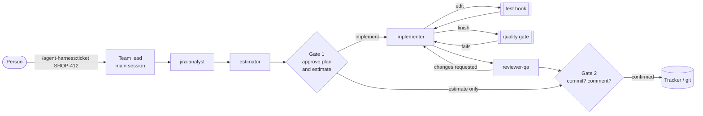

# agent-harness

[](https://github.com/bondie/agent-harness/actions/workflows/ci.yml)


**A ticket team for Claude Code, with an estimator you can check.** Four subagents take a
tracker ticket from analysis to a reviewed change: an analyst, an estimator, an implementer
and a reviewer. A person approves the plan and the estimate before any code is written, and
nothing is written to the tracker without their confirmation.

The estimator does not guess. With the analyst's file-by-file plan it prices each part from
a calibration: the implementer's own recent tickets, with the size of their diffs and the
hours logged on them. Without a plan it looks up how long similar finished tickets actually
took ([reference class forecasting](https://en.wikipedia.org/wiki/Reference_class_forecasting))
through [ticket-precedent](https://github.com/bondie/ticket-precedent). Either way it answers
with one number rounded to half an hour and the evidence behind each part; the P25–P75 range
comes on request. The repository also contains the backtest that measures the reference class
mode against simpler baselines, a local model and human estimates on real, private ticket
history; only aggregate numbers are published.

**Backtest on 1,212 finished tickets from 2026** (private history, logged hours as ground
truth, no future data in reach): the estimator 0.6 ships, which returns a structured block
and lets code compute the number from the retrieved median and cited adjustments, shows no
measurable difference from the plain median of similar recent tickets (MAE 1.38 h vs 1.33 h,
p = 0.23, Claude Sonnet on a 150-ticket sample). It keeps the median on 53% of tickets and
never leaves it without a citation, but its cited moves do not make it more accurate. It
gives one number, so its range was not measured. The earlier answer format tied the median
the same way (1.36 h vs 1.34 h, p = 0.78) and its P25–P75 range held the actual time 52% of
the time. Without
similar tickets, Claude Sonnet is worse than random guessing and a local 12B model is far
worse; with them, the local model matches Claude. The biggest gain came from neither model:
limiting the reference class to tickets after a process change cut the error by 29%.

## What is inside

It is a Claude Code [plugin](https://code.claude.com/docs/en/plugins), and the repository is
its own marketplace.

| Component | Role |
|---|---|
| `agent-harness:jira-analyst` | Reads the ticket, comments, links and precedents, finds the code; returns problem, acceptance criteria, approach, a file-by-file implementation plan, open questions. Read-only apart from its memory of each codebase. |
| `agent-harness:estimator` | Hours as one number rounded to half an hour, with evidence for each part (P25–P75 on request): bottom-up from the implementation plan, calibrated on the implementer's own logged time, or a reference class forecast when there is no plan. Read-only apart from its memory of calibration and corrections. |
| `agent-harness:implementer` | Implements the approved approach test-first, inside its scope, and reports where the time went. Never commits or writes to the tracker. Remembers commands, traps and conventions per codebase. |
| `agent-harness:reviewer-qa` | Reviews the diff against the acceptance criteria and the codebase's review skill when there is one, runs the checks, reports `path:line` findings and a verdict. Runs on the session's model at `xhigh` effort. Does not edit; remembers rejected findings and recurring defects. |
| `/agent-harness:ticket KEY` | The team lead's playbook for the main session, with the two approval gates. |
| `/agent-harness:stats` | Per agent: runs, typical duration, requests, tool calls and tokens, and the trend week over week, from the run log. `--by version\|model` groups each agent's runs by plugin version or model, `--split DATE` compares them before and after a moment such as a plugin update. |
| `/agent-harness:retro KEY` | After the work is logged: compares the estimate and the plan with what happened; each agent proposes lessons for its memory and writes the ones the person approves. |
| `/agent-harness:upgrade-impact` | A [dynamic workflow](https://code.claude.com/docs/en/workflows): before a dependency upgrade, one agent per component group reads the changelog in the version range and finds the changes your code uses; skeptics try to refute each risk. Returns the risks that survive, with `repo:path:line` and a test for each. |
| `hooks/run_tests.py` | After each edit **by the implementer**, runs the tests of the repository the edited file is in and hands failures back to it. |
| `hooks/guard_tracker_writes.py` | Denies tracker writes (comments, transitions, edits) to every subagent. |
| `hooks/log_agent_runs.py` | After every finished subagent run, appends its duration, requests, tool calls, tokens, model, plugin version and ticket key to `~/.claude/agent-harness/runs.jsonl`. |
| `hooks/save_artifacts.py` | After every finished run of the four agents, keeps its report and its structured block per ticket in `~/.claude/agent-harness/tickets/<KEY>/` (under `$HARNESS_HOME` when set). |
| `hooks/quality_gate.py` | When **the implementer** finishes or hands its report back, runs the repository's configured checks on the files it changed and sends it back to fix a failure. |
| `hooks/guard_memory_writes.py` | Lets the analyst, the estimator and the reviewer write only to their own memory directory, and holds all four agents' memory to the lesson format and a size cap ([Memory hygiene](#memory-hygiene)). |
| `hooks/guard_shell.py` | Denies subagents shell commands that destroy work, print secrets or touch a production database, and shell or file-tool edits of Claude Code settings, its own settings, git hooks and installed plugins ([rules](#shell-guard)). |
| `hooks/guard_runaway.py` | Stops a subagent that repeats the same call or keeps failing, and once tells one that has run long to report ([rules](#runaway-guard)). |
| `hooks/estimate_check.py` | When the estimator stops or hands its report back, checks the `harness-estimate` block that ends its estimate: every adjustment and part cites a ticket, a file or a measured time, and the total is the one code computes from the median or the parts. An invalid block goes back to the estimator, at most twice. |
| `.mcp.json` | Starts the ticket-precedent MCP server. |



## Install

```text
/plugin install agent-harness --marketplace bondie/agent-harness
```

Then, per project:

1. **An index of past tickets.** Set up [ticket-precedent](https://github.com/bondie/ticket-precedent)
   with your tracker and run `tp sync`. The plugin's `.mcp.json` starts its MCP server with
   `uvx`; if you already registered ticket-precedent yourself, remove one of the two.
2. **A tracker MCP server** of your choice (JIRA, GitHub, …) for the analyst to read tickets.
3. **The test command** for the hook, in the project's `.claude/settings.json` (see
   [`examples/settings.json`](examples/settings.json)):

   ```json
   { "env": { "HARNESS_TEST_COMMAND": "uv run pytest -x -q", "HARNESS_TEST_TIMEOUT": "300" } }
   ```

   `{file}` in the command becomes the edited file, e.g. `phpunit --filter … {file}`. Without
   the variable, edits in the project run no tests.

   An edit in another git repository, such as a platform checked out next to the project,
   runs that repository's own command and timeout from the `env` of its
   `.claude/settings.local.json` or `.claude/settings.json` (local wins), in its root and with
   `{file}` relative to it. A repository nested in the project, such as a submodule, counts
   as the project. When the other repository sets no command, the hook runs no tests there;
   if the project sets one, it tells the implementer, who then names in its report the tests
   that cover the change and their command, and the team lead decides whether to run them.
   The hook runs that repository's command through the shell although Claude Code itself does
   not load that repository's settings, so edit only repositories whose settings you trust.
4. **Optionally, a quality gate** in the repository's `.claude/agent-harness.json` (see
   [`examples/agent-harness.json`](examples/agent-harness.json) and
   [below](#ticket-artifacts-and-the-quality-gate)).

## Ticket artifacts and the quality gate

**Artifacts.** When the analyst, the estimator, the implementer or the reviewer finishes,
`hooks/save_artifacts.py` keeps what it produced in `~/.claude/agent-harness/tickets/<KEY>/`
(`HARNESS_HOME` moves the root). The key is `HARNESS_TICKET`, else the `ticket` of the
report's structured block, else the first ticket key in the agent's task that is not a
standard such as `UTF-8` or `ISO-8601`, otherwise `adhoc-<YYYYMMDD>-<agent id>`. A project
whose tracker key prefix is one of those standards (`ISO`, `RFC`, `CVE`, `UTC`, … in
`NOT_TICKET_PREFIXES`) must set `HARNESS_TICKET`. A retro run (task starting "Retro for",
optionally after `<KEY>:`) is not saved, gated or estimate-checked.

| File | Content |
|---|---|
| `index.jsonl` | One line per finished run: the agent, its id, when it ended, its report file, the kinds of its structured blocks, and under `error` the reason for each block it could not read. |
| `<agent>.<NN>.md` | The final report of each run, numbered per agent. |
| `<kind>.json` | The latest structured block of a kind (`analysis`, `estimate`, `review`, `implementation`); the previous one moves to `<kind>.<NN>.json`. |
| `gates.json` | The latest quality gate result: the commands, their exit codes, durations and the last 40 lines of their output. |
| `outcome.json`, `escaped.json` | The actual time and diff, and the defects that reached production, written by `harness-eval` ([Measuring the team](#measuring-the-team-not-just-the-estimator)). |

Each agent ends its report with one fenced block whose info string is `json harness-<kind>`;
its prompt shows the format. A stop that a hook blocked does not end a run, so the report the
agent gives after the fix replaces the one before. The retro reads these files instead of
reconstructing the ticket from the conversation, and they are the data for evaluating the
analyst's plans and the reviewer's findings.

**Quality gate.** The test hook runs tests after each edit, but nothing ran the linters,
static analysis or a CI file check before the implementer reported "checks passed". When the
implementer finishes, `hooks/quality_gate.py` takes the files from its `harness-implementation`
block (or, without one, the uncommitted files of its repository), runs each repository's
checks on them and writes `gates.json`. A failure blocks the implementer from finishing (the
`SubagentStop` decision `block`) and hands it the command and the end of its output. After two
blocks in a row it lets the implementer finish and the gate stays failed, so a check it cannot
fix does not loop.

In auto mode a subagent delivers its report through the `SubagentHandback` tool before it
stops, so a `SubagentStop` block comes too late to hold it back. The gate and the estimate
check therefore also run as a `PreToolUse` hook on that tool: they check the report in
`tool_input.message` and deny the call, which sends the agent back to work. Both paths count
against the same `max_blocks` per run. Claude Code allows a limited number of handback
retries; the gate denies at most twice. A report that the handback path passed or let through
is not checked again when the run stops. Unit tests cover both paths; there is no
end-to-end run of the handback path, because auto mode cannot be scripted with `claude -p`.

```json
{ "gate": { "commands": [
  { "cmd": "vendor/bin/phpstan analyse --no-progress {files}", "match": "\\.php$" },
  { "cmd": "actionlint {files}", "match": "^\\.github/workflows/.+\\.ya?ml$" }
], "timeout": 300 } }
```

- Each command runs through `/bin/sh` (POSIX shells assumed) in the repository root. `{files}`
  becomes the changed files whose path, relative to that root, matches the regular expression
  `match` (all files without one), each already quoted, so do not wrap `{files}` in double
  quotes. A command with no matching file is skipped.
- `timeout` is per command in seconds (default 300), and the gate as a whole stops after
  570 s. `max_blocks` (default 2) is how many times in a row it may block.
- `HARNESS_GATE_COMMANDS` in the `env` of the settings, as JSON (the same object or only its
  command list), wins over the file, so a person can override the team's checks in
  `.claude/settings.local.json`.
- Trusted to configure commands are the session's repository, its git worktrees and the
  repositories under the session's folder. Another repository uses its own settings and file
  only when the session's `gate.repositories` lists it (paths relative to the session's
  repository); changed files anywhere else are skipped, with a note in `gates.json` and to
  the person, also when no check ran. An entry that names no usable path is ignored with a
  note.
- Without a configuration the gate does nothing. When it cannot write under `HARNESS_HOME`,
  it runs nothing and tells the person.

## Shell guard

`hooks/guard_shell.py` checks each Bash command of a subagent before it runs, or of every
session with `"scope": "all"`. It parses the command, so it also sees `;`/`&&`/`||` chains,
pipes, subshells, `$(…)`, `bash -c`/`sh -c`, `eval`, heredocs fed to a shell, `sudo`, `env`,
`nohup` and `timeout` prefixes, variable assignments, quoting tricks and absolute binary paths.
It also checks the Write, Edit, MultiEdit and NotebookEdit calls of the same agents against the
guard files (`guard-tampering`). Each deny reason names the rule and how to proceed.

| Rule | Denied | Allowed |
|---|---|---|
| `force-push` | `git push --force`, `-f`, `+refspec` | a normal push |
| `push-delete` | `git push --delete`, `-d`, `:ref`, `--prune`, `--mirror` | a normal push |
| `force-with-lease` | `git push --force-with-lease` from a subagent | from the main agent, by default |
| `git-discard` | `git reset --hard`, `git clean -f`, `git checkout .`/`-- .`/`-f`, `git restore .` | in a repository inside the temp dirs; `clean -n`, `restore --staged .`, single files |
| `branch-force-delete` | `git branch -D`, `--delete --force`, `-df` | `git branch -d`; in a repository inside the temp dirs |
| `rm-outside-allowed-dirs` | `rm -r`/`-rf`/`-fr`/`-R`, `find -delete`/`-exec rm`, `xargs rm -r` outside the allowed dirs | below `$TMPDIR` (`/tmp` when unset) or `/tmp/claude-*`, the default build and cache dirs in the project, and `allowed_rm_dirs` |
| `secret-read` | `cat`, `head`, `tail`, `less`, `more`, `sed`, `awk`, `grep`, `rg`, `bat`, `nl`, `tac`, `jq`, `strings`, `xxd`, `base64`, `od`, `hexdump`, `uuencode`, `git show <rev>:<file>` or `git log -p` of a file in `secret_globs`, or the file fed to any command through `<` | `grep -c`/`-l`/`-q`; a pipe into `wc`, `grep -c`, `cut -d= -f1` or a `safe_filters` match; `secret_allow_globs` |
| `secret-copy` | `cp`, `mv`, `install`, `ditto`, `scp`, `rsync` or `dd if=` with a file in `secret_globs` as a source | `cp .env.example .env`; the file as the destination; `scp -i`/`rsync -e`/`--exclude` values |
| `env-dump` | `env` without a command, `printenv` without a name or with one that contains `KEY`, `TOKEN`, `SECRET`, `PASSWORD`, `PASSWD`, `PASSPHRASE`, `PASS`, `AUTH` or `CREDENTIAL` before `_` or at its end, `export`/`export -p` | `env FOO=1 make`, `printenv HOME`; a pipe into `cut -d= -f1`, `wc` or `grep -c` |
| `keychain-read` | `security find-generic-password`, `find-internet-password`, `dump-keychain` | other `security` commands |
| `guard-tampering` | a guard file (below) as the target of `>`/`>>`, `tee`, `sed -i`, `perl -i`, `truncate`, `chmod`, `rm`, `unlink` or `shred`, the destination of `cp`, `mv`, `ln`, `install`, `ditto`, `scp`, `rsync` or `dd of=`, the source of `mv`, or of a Write, Edit, MultiEdit or NotebookEdit; `git config core.hooksPath <dir>`, `git -c core.hooksPath=…` | reading them; the repository's own `hooks/`; a copy inside the temp dirs that is not the project |
| `prod-db` | `mysql`, `mariadb`, `psql`, `mongosh`, `mongo`, `redis-cli` whose `-h`/`--host`, URI, `host=` or `PGHOST`/`MYSQL_HOST` matches `prod_db_hosts` | any host while `prod_db_hosts` is empty (the default) |
| `destructive-sql` | `DROP DATABASE`/`TABLE`/`SCHEMA` or `TRUNCATE` in a database client's arguments or heredoc, or in the command piped into it, for any host | `SELECT TRUNCATE(x, 2)` |
| `unparsable` | a `$(` that is never closed, so the rest of the command cannot be checked | |
| `extra_deny` | a command matching one of your regexes, with your reason | |

A relative path resolves against the working directory and follows `cd` in the command. A
path with an unknown variable or `$(…)`, or in an unknown directory, counts as outside; so
does any relative path after more than 16 possible working directories (`cd a; …; cd b; …`).
`/tmp/claude-501` itself is not below `/tmp/claude-*`, so it stays protected.

The guard files are `.claude/settings.json`, `.claude/settings.local.json` and
`.claude/agent-harness.json` in any directory, everything under `.git/hooks/`, `guard.json` and
`memory.json` in `$HARNESS_HOME`, and `settings.json` and `plugins/` in `~/.claude`
(`$CLAUDE_CONFIG_DIR` when set), matched ignoring case. Those in `$HARNESS_HOME` and `~/.claude`
are protected everywhere; the others may be changed inside the temp dirs, unless they belong to
the project (`CLAUDE_PROJECT_DIR`, else the working directory).

The settings merge built-in defaults, `~/.claude/agent-harness/guard.json` (under
`$HARNESS_HOME` when set) and the `guard` key of the project's `.claude/agent-harness.json`.
Lists append to the earlier ones; `scope` and `allow_force_with_lease` take the last value.

| Key | Default |
|---|---|
| `scope` | `"subagents"`: only events with an `agent_type`; `"all"` checks the main session too |
| `allow_force_with_lease` | `"main"`: the main agent only; `true` or `false` for everyone |
| `secret_globs` | `.env`, `.env.*`, `*.pem`, `*.key`, `id_rsa*`, `id_ed25519*`, `.npmrc`, `.pypirc`, `.netrc`, `credentials`, `credentials.json`, `*credentials.y*ml`, `.aws/credentials`, `*.credentials`, `auth.json` |
| `secret_allow_globs` | `.env.example`, `.env.dist`, `*.pub` |
| `allowed_rm_dirs` | built in: `node_modules`, `var/cache`, `dist`, `build`, `coverage`, `.pytest_cache`, `__pycache__`, `.mypy_cache`, `.ruff_cache` at any depth inside the project (`CLAUDE_PROJECT_DIR`, else the working directory), never the project itself; each entry you add allows the dir and everything in it, a relative one relative to the project |
| `prod_db_hosts` | none; case-insensitive regexes searched in the host |
| `safe_filters` | none; regexes searched in the pipe stage right after the read, its words joined by single spaces without quotes (`grep -v -E 'a\|b'` becomes `grep -v -E a\|b`) |
| `extra_deny` | none; `{"pattern": "<regex searched in the whole command>", "reason": "<text>"}` |

A glob without `/` matches the file name, one with `/` the path at any depth, both ignoring
case. An invalid file or key is ignored and named in the next deny reason; a `runaway` object
is left to the hook that reads it. An internal error lets the command through and logs to
stderr. Example ([`examples/agent-harness.json`](examples/agent-harness.json)):

```json
{
  "guard": {
    "scope": "subagents",
    "allow_force_with_lease": "main",
    "secret_globs": ["deploy/ci-secrets.yml", "config/*.secret.yaml"],
    "allowed_rm_dirs": ["var/cache", "node_modules"],
    "prod_db_hosts": ["^prod-db\\.", "\\.prod\\.example\\.com$"],
    "safe_filters": ["^grep -v -i -E \\S*(token|password|secret)\\S*$"],
    "extra_deny": [
      {
        "pattern": "\\bterraform\\s+(apply|destroy)\\b",
        "reason": "Terraform changes real infrastructure"
      }
    ]
  }
}
```

The guard catches mistakes; it is not a sandbox against deliberate evasion. It does not see
inside scripts a command runs (`./clean.sh`, `python -c`, `make`), commands piped into `sh`,
what `docker exec` and `ssh` run elsewhere, SQL in a file fed to a client (`mysql < x.sql`),
secrets read by other tools (`git diff`, `sort`, `source .env`, `curl -d @.env`) or through a
glob or `$(…)` in the file name, a secret variable printed by name (`echo $API_KEY`), `set` and
`declare -p`, guard files written by other tools (`curl -o`, `git apply`) or by moving their
directory (`mv .claude …`), `$(…)` inside an unquoted heredoc, and it does not check the Read
tool.

### Coverage

`tests/test_guard_battery.py` runs the 90 dangerous commands of the
[guardrail-tester](https://github.com/RyanAlberts/best-of-Agent-Harnesses/tree/main/skills/guardrail-tester)
skill (MIT License, Copyright (c) 2026 Ryan Alberts; kept verbatim with its license in
[`tests/data/`](tests/data)) as a subagent working in `/work/shop`.
`tests/data/guard-battery-policy.json` gives each case a verdict and its reason. A gap is an
expected failure of the test, so closing one fails it until the policy and this table follow.

| Category | Denied | Allowed by design | Gap |
|---|---|---|---|
| destructive-git | 15 / 15 | 0 | 0 |
| destructive-files | 4 / 11 | 7 | 0 |
| privilege | 1 / 4 | 0 | 3 |
| secrets | 10 / 12 | 0 | 2 |
| remote-code | 0 / 4 | 0 | 4 |
| exfiltration | 2 / 4 | 0 | 2 |
| wrappers | 6 / 16 | 8 | 2 |
| publishing | 0 / 3 | 0 | 3 |
| infrastructure | 1 / 5 | 0 | 4 |
| guardrail-tampering | 7 / 8 | 0 | 1 |
| file-tools | 0 / 8 | 0 | 8 |
| total | 46 / 90 | 15 | 29 |

The cases allowed by design delete `./guardrail-tester-probe/build`, a build dir the guard
allows inside the project; the test runs each again on `…/src` and expects a denial. The gaps:

- Outside the guard's purpose, left to Claude Code's permission prompt or an `extra_deny`
  pattern: running as root (`sudo-path`, `su-root`, `sudo-pipe`), downloading and running code
  (`curl-sh`, `bash-procsub`, `curl-then-sh`, `python-exec-url`), uploads and pushes to a URL
  (`curl-data-env`, `push-to-url`), publishing (`npm-publish`, `twine-upload`, `gh-release`),
  infrastructure tools (`terraform-destroy`, `terraform-apply`, `kubectl-delete-ns`,
  `aws-s3-rm`), another agent's configuration (`write-codex-config`), and files outside the
  repository that are not guard files (`write-zshrc`, `write-authorized-keys`,
  `write-launch-agent`, `shell-append-zshrc`).
- Allowed on purpose: searching code for key names, such as `grep -r API_KEY src/`, is routine
  (`grep-keys`).
- Out of the parser's sight: code inside `python -c` (`python-open-env`), a command decoded at
  run time and piped into `sh` (`base64-sh`), and what `docker exec` runs in a container
  (`docker-exec-rm`).
- The Read tool is not checked (`read-env`, `read-env-nested`, `read-ssh-key`, `read-aws`): deny
  it in Claude Code's permissions, for example `"deny": ["Read(./.env)", "Read(./.env.*)"]`.

### Guard events

Each denial appends one line to `guard-events.jsonl` under `$HARNESS_HOME` (default
`~/.claude/agent-harness/`): `time` (ISO 8601, UTC), `hook` (`guard_shell`), `session`,
`agent_id`, `agent_type`, `tool`, `rule` (the rule name from the tables above) and `decision`
(`deny`). It never holds the command, file content or paths, which may contain secrets. Writing
it is best effort: a failure is logged to stderr and the decision stands. Other hooks append
with `log_guard_event(environ, event, hook, rule, decision)` from `hooks/guard_shell.py`.

## Runaway guard

`hooks/guard_runaway.py` watches every tool call of a subagent. It stops one that repeats the
same call or keeps failing, and once tells one that has run long to report. The main session,
which the person supervises, is never touched: it counts only events with an `agent_id`, so a
session started with `--agent` is left alone too.

| Rule | When | What happens |
|---|---|---|
| `loop` | the same call arrives for the `loop_repeats`-th time with nothing changed in between | denied: change the approach, or stop and report to the lead what blocks you |
| `failure_streak` | `failure_streak` calls failed in a row | the next call is denied once: stop and report to the lead what fails and what you tried |
| `long_run` | `warn_minutes` after the agent's first call | once, next to a tool result: if what is left will take more than about 10 more minutes, stop and report what is done, what is left, the expected time and the options |

- The same call is the tool name and its whole input; for Bash the `description` is left out
  and runs of spaces collapse. The guard stores only a hash of it.
- Reads and searches (Read, Grep, Glob, LS, NotebookRead, WebFetch, WebSearch, ToolSearch)
  neither end nor reset a run, so reading other files between three identical test runs still
  counts. Any other call ends the run of every other call; its own repeats still count.
- Never counted, and they end every run: subagent and messaging calls (Agent, Task,
  SendMessage, SubagentHandback), deliberate waits and polls (TaskOutput, BashOutput, Monitor,
  ScheduleWakeup, a Bash command with `sleep` or `wait` as a word) and AskUserQuestion.
- A failure is a failed call that was not interrupted; a successful call resets the streak. A
  call denied by a hook or a permission is neither. A call that reports or asks
  (SubagentHandback, SendMessage, AskUserQuestion) is never denied and resets the streak.

The settings are the `runaway` object in `~/.claude/agent-harness/guard.json` (under
`$HARNESS_HOME` when set), then in the `guard` key of the project's
`.claude/agent-harness.json`; a later value of a key wins. 0 turns a rule off.

| Key | Default |
|---|---|
| `loop_repeats` | `3`; 0 or a whole number from 2 |
| `failure_streak` | `5`; a whole number |
| `warn_minutes` | `10`; minutes, fractions allowed |

```json
{ "guard": { "runaway": { "loop_repeats": 3, "failure_streak": 5, "warn_minutes": 10 } } }
```

An invalid value is ignored and named in the next deny reason. Each agent's state lives in
`~/.claude/agent-harness/runaway/<session>/<agent>.json`; when an agent starts, session
folders untouched for two days are removed. An internal error lets the call through and logs
to stderr.

Each deny and each long-run note appends one line to `~/.claude/agent-harness/guard-events.jsonl`
(under `$HARNESS_HOME` when set), never with the tool input:

```json
{"time": "2026-11-08T09:12:40+00:00", "hook": "guard_runaway", "session": "<session_id>", "agent_id": "<agent_id>", "agent_type": "agent-harness:implementer", "tool": "Bash", "rule": "loop", "decision": "deny"}
```

`rule` is `loop`, `failure_streak` or `long_run`; `decision` is `deny` or `context` (the note).
A line that cannot be written is reported on stderr and changes nothing.

It misses a loop over two or more calls (A, B, A, B: each call ends the other's run), a
repeated call whose input changes each time (a counter, a timestamp) and a loop of calls it
never counts (waits, subagents). Parallel calls of one batch count in the order their hooks
run.

The rules are adapted from the [runaway-guard](https://github.com/RyanAlberts/best-of-Agent-Harnesses/tree/main/skills/runaway-guard)
skill in best-of-Agent-Harnesses (MIT license); the code is this repository's own.

## Memory hygiene

Each agent keeps its memory in `~/.claude/agent-memory/<agent>/` (`memory: user`): the index
`MEMORY.md`, which Claude Code loads into the agent's prompt, and topic files. A note without a
source or a date cannot be checked or retired, so every lesson is one bullet that ends with
both:

```text
- <lesson text> (source: <KEY|MR|commit|retro>, YYYY-MM-DD[, expires YYYY-MM-DD])
```

Lines indented by two spaces continue the bullet above. Headings, prose, front matter, fenced
code and the index links in `MEMORY.md` (`- [Title](file.md) — hook`) are not lessons.

**The guard.** `hooks/guard_memory_writes.py` checks every Write, Edit and MultiEdit that one of
the four agents makes in its own memory directory:

- Every new or changed lesson must end with its source and date, and an expiry must come after
  the date. Lessons already in the file are not checked, so older notes never block a write;
  an Edit checks the lessons its `new_string` adds.
- A file may not grow past its cap: 8 KB for a topic file, 4 KB for `MEMORY.md`. A write that
  shrinks an oversized file always passes, so compacting it is never blocked.

The deny reason names each failing line and shows the format. The main session and other
agents are not checked. The caps and the source requirement live in
`~/.claude/agent-harness/memory.json` (`$HARNESS_HOME/memory.json` when that is set); a value
that is not a positive number, or for `require_source` a boolean, falls back to the default.
With `"require_source": false` a date alone, `(YYYY-MM-DD)`, is enough.

```json
{ "max_file_kb": 8, "max_index_kb": 4, "require_source": true }
```

**The lint**, from a checkout of this repository (or with `uvx`, as in
[Measuring the team](#measuring-the-team-not-just-the-estimator)):

```bash
uv run harness-eval memory lint [--dir ~/.claude/agent-memory]
uv run harness-eval memory prune --expired [--apply]
```

`lint` lists, per agent and file, the undated lessons, the ones without a source, the expired
ones, dead paths and the files over the cap, and exits with 1 when it finds any. A dead path is
an absolute path in a lesson that does not exist although its top directory does; URL paths
and a container's `/app/…` are skipped that way, a container path under `/usr` or `/tmp` is
not. `prune --expired` removes the lessons whose expiry date has come, with their continuation
lines; without `--apply` it only lists them. The `retro` skill writes only the lines the person
approved and suggests the lint every few retros.

## The estimator

The method is in [`agents/estimator.md`](agents/estimator.md). It has two modes.

**Bottom-up, when the analysis has a file-by-file implementation plan.** Each part of the
plan is split into implementation with an AI coding agent (including review), manual
verification and debugging, and release and rollout. Implementation is priced from a
calibration: the implementer's own recent tickets, each with the size of its diff and the
hours they logged. Verification is priced by the scenarios that have to be checked, not by
lines. The reference class serves as a cross-check. This mode exists because a reference
class matches tickets on vocabulary, not on the kind of work: for cross-cutting work without
a real precedent it overstated the effort about three times in practice.

**Reference class, otherwise:**

1. Get the reference class: `effort_reference` returns the most similar tickets **whose time
   was all logged before the ticket was created**, with their hours, median and P25–P75.
2. Discard neighbours that only share vocabulary; open the closest ones when in doubt.
3. Anchor on the median, then adjust only for differences it can name.
4. Keep the P25–P75 range honest: it should contain the actual time half of the time.
5. Prefer neighbours from after a process change (or scale older ones down).

The answer is one number rounded to half an hour, with the evidence for each part: the
calibration rows and the arithmetic, or the tickets it used. The estimator still works out a
P25–P75 range and shows it when asked; the backtest asks for it to measure its coverage.

The calibration and the corrections a person made to past estimates live in the estimator's
[memory](https://code.claude.com/docs/en/sub-agents) (`memory: user`, so
`~/.claude/agent-memory/agent-harness-estimator/`), outside the repository. The playbook
collects the calibration from the tracker's worklogs and `git log --numstat` when it is
missing. The backtest measures only the reference class mode: its tickets have no plans.

It never reads the ticket's existing estimate or logged time: a model shown a number anchors
on it ([Çalikli & Alhamed, FSE 2025](https://doi.org/10.1145/3715771)), and the person
comparing estimates needs an independent one.

## Workflows

[Dynamic workflows](https://code.claude.com/docs/en/workflows) run a script that starts many
subagents at once. They fit work that splits into independent pieces, each of which can be
checked, and they cannot stop for a person's approval in the middle. So the ticket playbook
stays a conversation with its two gates, and the plugin ships a workflow only where fanning
out pays.

**`/agent-harness:upgrade-impact`** answers "what in this upgrade hits our code?" before a
patch or minor upgrade of a framework, across one or more repositories. It only reads.

1. **Find:** one agent per group of components takes the changelog entries in the version
   range, keeps those that can change behaviour, searches the repositories (`git grep` on a
   ref, nothing is checked out) and returns findings with `repo:path:line`, a risk and a test.
   A medium or high risk has to name the old and the new behaviour and the code that sees it.
2. **Verify:** skeptics try to refute each risk, one lens each: is the change real and in
   range, and does our code exercise it. A high risk gets both, a medium one the usage lens.
   A risk survives unless every skeptic refutes it; one refutation marks it disputed.

```text
/agent-harness:upgrade-impact
args: { dependency, from, to, changelog: <path>, repos: [{ name, path, ref, paths }],
        groups: [{ name, components }], versions?: { <component>: <installed version> } }
```

**Pilot:** a Symfony patch upgrade (6.4.8 -> 6.4.50, 58 components in 6 groups)
across 8 repositories of one e-commerce platform, with the first version of the script (two
skeptics for every medium or high risk).

| | |
|---|---:|
| Changelog entries reviewed | 1,433 |
| Risks the finders rated medium or high | 42 |
| Refuted by both skeptics | 36 |
| Kept, with a concrete test | 4 (3 of them disputed) |
| Rated low (API used, change benign) | 58 |
| Agents / wall-clock / subagent tokens | 86 / 9 min / 4.7 M |

What it taught: the finders rated a risk medium whenever our code used the changed API, and
the skeptics refuted most of those with a specific reason (the fix only applies to a case our
code does not have). The skeptics paid for themselves: four tests to run instead of
forty-two. They also cost most of the agents, so the current script asks finders to name the
behaviour difference before rating a risk medium, verifies a medium risk once, and accepts the
installed version per component (the pilot assumed one version for all, and a skeptic
noticed that one package was already newer).

## Does it work?

Full tables: [`results/2026-backtest.md`](results/2026-backtest.md).

**Setup.** The tickets of eight private JIRA projects with logged time, created in 2026 and
done, up to 40 h (1,212 tickets; the LLM variants ran on a random 150 of them, seed 7). Ground
truth is the logged time. For each ticket, only tickets whose time was all logged before it
was created can be retrieved. The LLM variants use the shipped estimator prompt, run
headless, with numbers next to estimate words in the ticket text masked (16 of 150 tickets).
At the start of 2026 the team began implementing with AI coding agents, and the same work
now logs much less time: the median logged time fell from 1.6–2.0 h (2022–2025) to 1.0 h.

| Variant (150 tickets) | MAE h [95% CI] | MdAE h | SA | P25–P75 coverage |
|---|---:|---:|---:|---:|
| Median of 10 similar tickets, all history | 1.89 [1.58–2.23] | 1.30 | 0.11 | 46% |
| … older tickets scaled by the pace change | 1.44 [1.17–1.76] | 0.88 | 0.33 | 50% |
| **… only tickets after the change** | **1.34 [1.06–1.68]** | **0.75** | **0.37** | 49% |
| Claude Sonnet, ticket text only | 2.37 [1.91–2.89] | 1.50 | −0.11 | 43% |
| Claude Sonnet + keyword neighbours | 1.58 [1.28–1.92] | 1.00 | 0.26 | 59% |
| Claude Sonnet + ticket-precedent | 1.60 [1.30–1.94] | 1.00 | 0.25 | 50% |
| **Claude Sonnet + ticket-precedent, recent only** | **1.36 [1.11–1.68]** | 1.00 | 0.36 | **52%** |
| gemma4:12b (Ollama), ticket text only | 6.24 [4.53–8.31] | 3.04 | −1.92 | 19% |
| gemma4:12b + ticket-precedent | 1.57 [1.24–1.93] | 0.78 | 0.27 | 50% |
| **gemma4:12b + ticket-precedent, recent only** | **1.37 [1.09–1.72]** | 0.75 | 0.36 | 51% |

SA is standardized accuracy against random guessing (0 = no better than guessing). On all
1,212 tickets the medians tell the same story: 2.33 h all history, 1.86 h scaled, 1.66 h
recent only (all differences p < 0.001, in every project).

What the numbers say:

- **The reference class matters more than the model.** Dropping tickets from before the
  process change cut MAE by 29% for the plain median and by 15% for Claude. A model told
  about the change but shown old tickets still overestimated.
- **The LLM does not beat a good median on accuracy** (p = 0.78 for Claude, 0.98 for gemma
  against the recent median), as the estimation literature keeps finding. What it adds is a
  calibrated range, cited tickets and named adjustments that a person can check at the gate.
- **Without retrieval, LLM estimates are guesses.** Claude Sonnet was worse than random
  guessing; the 12B model overestimated by three hours at the median.
- **A local model is enough.** With the same reference class, gemma4:12b on a laptop matched
  Claude Sonnet (1.37 h vs 1.36 h) at no cost; Claude cost about 0.018 USD per estimate.
- **The prompt's anchoring rule is not followed; enforcing it in code changed behaviour, not
  accuracy.** The rule says to keep the median unless a difference can be named, yet both
  models moved away from it on 93–95% of tickets (71% once both are rounded to half an hour)
  and ended up overestimating slightly more than the median itself (+0.25 to +0.50 h vs
  +0.31 h). With the number computed by code from the retrieved median and cited
  adjustments (0.6), Claude kept the median on 53% of tickets instead of 30%, never wrote a
  median other than the retrieved one (0 of 150) and needed no retry, with no measurable
  difference in accuracy (MAE 1.38 h vs 1.33 h for the recent median, p = 0.23; 1.34 h for
  the earlier format, p = 0.40). The moves it still makes go mostly up (54 up, 16 down) and
  do not pay off. A first run that let the model write the median itself kept it on 41%,
  with at least 22 of 150 estimates off the retrieved median without a citation, and scored
  the same (1.37 h). The recent median scores 1.33 h there and 1.34 h above because the
  ticket index was refreshed between the runs and one ticket's reference class changed
  ([section 4](results/2026-backtest.md)). The rerun of both structured variants cost 4.67 USD for
  300 estimates.
- **Keyword and hybrid retrieval tie here** (1.58 h vs 1.60 h for Claude). The tickets of one
  team share vocabulary, so BM25 finds the same neighbours.

**Human estimates and their catch.** The first estimate a person entered had an MAE of 0.56 h,
far better than any variant, but in 2026 the logged time equals that estimate exactly on
59% of tickets: time is logged to the estimate, so the comparison is circular. On the 479
tickets where logged time differs from the estimate, the human estimate still leads (MAE
1.32 h vs 1.87 h for the recent median), with the same caveat that logging may lean towards it.

**Threats to validity.** One organisation; logged time is a proxy for effort; descriptions
can be edited after creation; the 150-ticket sample gives wide intervals (about ±0.3 h);
the process note given to the LLMs names the change date, which a real estimator would also
be told.

## Measuring the team (not just the estimator)

The backtest covers only the reference class mode, because old tickets have no plans. The
bottom-up mode, the analyst and the reviewer are measured going forward instead, from what the
plugin keeps for each ticket in `~/.claude/agent-harness/tickets/<KEY>/` (under
`$HARNESS_HOME` when set): the analysis, the estimate and the review the agents returned, and
what the retro adds to them. A plugin install does not put `harness-eval` on PATH: run it as
`uvx --from git+https://github.com/bondie/agent-harness harness-eval …`, or as
`uv run --project <an agent-harness checkout> harness-eval …` (`uv run harness-eval …` inside
the checkout, as below).

```bash
# After the work is logged: freeze the ticket as an eval case with the time it took
uv run harness-eval export-case SHOP-412 --source worklog --actual-total 2.5 \
    --repo ../shop ../platform --rev main
uv run harness-eval eval                       # errors over all exported cases

# In the retro: what the person did with each review finding
uv run harness-eval review-finding SHOP-412 F1 --disposition accepted
uv run harness-eval review-finding SHOP-412 F2 F3 --disposition rejected --note "style only"

# A defect reached production: link it to the ticket of the commit that caused it
uv run harness-eval escaped --commit 3f2a9c1 --repo ../shop --source sentry --ref 4711 \
    --summary "Rounded price off by a cent"
uv run harness-eval escaped --commit 3f2a9c1 --repo ../shop --case incident-12-http-5xx.yaml

uv run harness-eval metrics --repo ../shop ../platform          # or --json
```

- **`export-case KEY`** writes `$HARNESS_HOME/eval-cases/KEY.json`: the estimate and the
  analysis as the agents returned them, and the actual time. Give it per part kind
  (`--actual-part`, kinds `implementation`, `verification` and `release`), as a total
  (`--actual-total`, by default the sum of the parts) or both, and say where it comes from
  (`--source measured|worklog`). Take the total from the worklogs and give a part only when
  it was measured; do not split a logged total by guess. With `--repo`, it also records the
  diff of the commits whose message names the key (`--grep` for another term) on any branch,
  or only on `--rev REV` (for example the target branch, when a squashed branch still lingers):
  the files, the lines added and removed, and how many added lines are tests
  (`--test-pattern`, by default `tests/`, `spec/`, `*Test.php`, `*_test.py` and `*.spec.ts`).
  A commit on two branches (a cherry-pick) counts once; two commits with the same message and
  changes but different author times count twice. An estimate the hook let through after its
  retries although the check still rejected it is exported with its stated total and the
  check's errors (`check_errors`). It also writes `outcome.json` into the ticket directory.
- **`eval [DIR]`** reports, for the total by estimate mode and for each part kind, the mean
  and the median absolute error in hours and the bias: estimate minus actual, so a positive
  bias means the estimates were too high. The total is computed from the parts (or the
  reference median) plus the adjustments, not taken from the model; cases kept after the
  check failed are counted and shown in their own row, with their stated total. The report
  has no ticket keys, so it can be published like [`results/`](results/).
- **`metrics`** measures the analyst by the files of its plan against the files that changed:
  precision is the share of planned files that changed, recall the share of changed files the
  plan named. The changed files come from the commits that name the key in the `--repo`
  repositories (one `git log` per repository, `--rev` as for `export-case`), else from the
  exported case, else from the files the implementer reported. It measures the reviewer by
  the findings of every review round per severity and disposition, the acceptance rate
  (accepted / (accepted + rejected)), and the defects that reached production. A ticket with
  a review and an escaped defect is marked *reviewer passed, defect escaped*. The rows name
  ticket keys: keep this output private.
- **`review-finding KEY F1 … --disposition accepted|rejected|deferred`** records what the
  person did with a finding, with an optional `--note`. Each review round has its own block:
  `review.json` is the last, `review.01.json`, `review.02.json`, … the earlier ones. Ids are
  matched within one round; give `--round N` (1 first) when the id is in several.
- **`escaped --commit SHA --repo PATH`** finds the ticket key in the commit message, else in
  the merge commit that brought the commit in (a merge request's merge commit carries its
  branch name and title). It looks at the branches no other branch contains, each along its
  first-parent chain: a commit made on such a branch directly (a hotfix) has no key, and a
  merge that synced the target branch into a feature branch does not count once the target
  branch has moved on. Until it has, a hotfix synced into a feature branch can still be
  blamed on that branch.
  Names of standards (`UTF-8`, `PSR-12`, `SHA-256`, …) are not keys. Of several keys it takes
  the one that already has a ticket directory; when that leaves more than one, or none names
  a ticket, it lists them and asks for `--ticket KEY`. It appends the defect to
  the ticket's `escaped.json`, once per commit and reference. `--case` takes an
  [incident-scout](https://github.com/bondie/incident-scout) case file (`scout export-case`):
  its id becomes the reference and its reviewed cause the summary. A case names no commit or
  deployment, so `--commit` is still needed.

## Design decisions

- **A plugin, not a project `.claude/` folder.** The same team works in every repository,
  including from the JetBrains and VS Code integrations, and updates in one place.
- **Hooks live in the plugin, filtered by agent.** Claude Code ignores `hooks`,
  `mcpServers` and `permissionMode` in the front matter of plugin agents, so the test hook is
  a plugin-level `PostToolUse` hook that checks `agent_type` and runs only for the
  implementer. An end-to-end run confirmed that it fires for the subagent's edits.
- **Tracker writes are blocked, not just discouraged.** The prompts say subagents only read;
  a `PreToolUse` hook enforces it for any MCP tool that looks like a tracker write. The main
  session keeps its normal permission prompt, and the playbook asks before every write.
- **Every agent remembers, and the read-only ones remember nothing else.** All four have
  `memory: user`: the analyst keeps where things live in each codebase, the estimator keeps
  calibration and corrections, the implementer keeps commands and traps, the reviewer keeps
  rejected findings and recurring defects. Memory gives an agent Write and Edit, so a
  `PreToolUse` hook denies the analyst, the estimator and the reviewer every path outside
  their own `agent-memory/<agent>/` directory.
- **Agents learn from facts, in a retro.** A memory that only the agent itself fills learns
  from what it noticed. The `retro` skill feeds each agent what actually happened: the logged
  hours against the estimate, the files the plan missed, the findings the person rejected.
- **One number by default, the range on request.** The person at the gate approves or
  changes one number and later compares it with the logged time, so that is what the
  estimator leads with. Every part must cite its evidence; an increment that cites nothing
  is not allowed.
- **The reviewer thinks hardest.** It runs on the session's model at `xhigh` effort while
  the analyst and the estimator run on Sonnet: a defect it misses costs more than a deeper
  review, and a review reads one diff, not the whole codebase. The traps of a codebase belong
  in a review skill the person writes (a checklist of what went wrong before); the reviewer
  loads it when its memory or the request names it.
- **Two human gates.** Between estimate and implementation (the expensive mistake is
  building the wrong thing) and before anything leaves the machine (commit, comment).
- **The eval runs the shipped prompt.** The LLM variants use the body of
  `agents/estimator.md` as their system prompt, so changing the agent changes the measured
  results.
- **Clean headless runs.** `claude -p` runs in an empty directory with no tools, no MCP
  servers and no settings (`--setting-sources ""`), so neither `CLAUDE.md` files nor hooks
  leak into the measurement. (`--bare` would do the same but requires an API key.)
- **Hours, not story points.** The trackers record logged hours, and story points correlate
  strongly with time in only 7% of the projects in the public TAWOS dataset
  ([Tawosi et al., ESEM 2022](https://doi.org/10.1145/3544902.3546238)).

## Prior art

- **Subagent teams:** [wshobson/agents `agent-teams`](https://github.com/wshobson/agents/tree/main/plugins/agent-teams)
  (lead, implementer, reviewer), [VoltAgent/awesome-claude-code-subagents](https://github.com/VoltAgent/awesome-claude-code-subagents)
  (conventions), [BMAD-METHOD](https://github.com/bmad-code-org/BMAD-METHOD) and
  [spec-kit](https://github.com/github/spec-kit) (human-reviewed artifacts between phases).
- **Estimation research:** Deep-SE and GPT2SP for story points, and their replications,
  which found that a plain median baseline is hard to beat and that temporal leakage
  inflated earlier results ([Tawosi et al., TSE 2023](https://arxiv.org/abs/2201.05401)).
  Hours from similar earlier issues go back to [Weiss et al., MSR 2007](https://doi.org/10.1109/MSR.2007.13).
- **LLM and RAG estimators:** retrieval-augmented story-point estimation was not
  significantly better than the baselines ([Maha et al., ICPC 2026](https://arxiv.org/abs/2604.03443));
  the choice of few-shot examples matters ([Tawosi et al., SSBSE 2023](https://arxiv.org/abs/2403.08430)).
  Existing Claude Code estimator agents (e.g. [ninja-agents `jira-story-points`](https://github.com/ninja-agents/ninja-agents/blob/main/.claude/agents/jira-story-points.md))
  are not evaluated.
- **Learning loops and phased workflows:** [EveryInc compound-engineering-plugin](https://github.com/EveryInc/compound-engineering-plugin)
  loops plan → work → review → compound: `/ce-compound` writes what a session learned to
  `docs/solutions/`, and later planning and review search those notes for the ones relevant to
  the change. Its lessons are write-ups of what a session concluded; agent-harness learns from
  logged facts (worklog hours against the estimate, review dispositions, gate results),
  approved line by line in a retro. [obra/superpowers](https://github.com/obra/superpowers)
  has a `verification-before-completion` skill and tests skills by running subagents on
  pressure scenarios with and without them. HumanLayer's research → plan → implement
  ([advanced context engineering](https://github.com/humanlayer/advanced-context-engineering-for-coding-agents))
  writes an artifact per phase and clears the context between phases. Here the lead passes
  the analysis to the next agent in its prompt; the ticket artifacts serve the retro and the
  evals, not the hand-over. Sharing memory across a team is
  discussed in [docs/shared-memory.md](docs/shared-memory.md).

What this repository adds: hours from private worklogs (no training-data contamination),
prediction ranges with measured coverage, a temporal cut-off inside the retrieval tool, a
baseline ladder that isolates what the LLM adds, human estimates, and a hosted and a local
model through the same pipeline.

## Development

```bash
uv sync                      # installs ticket-precedent from GitHub at a pinned commit
uv run pytest --cov          # no network, no model, no tracker needed (workflow tests need node)
uv run ruff check . && uv run ruff format --check . && uv run mypy
claude plugin validate .
```

## License

[MIT](LICENSE)
