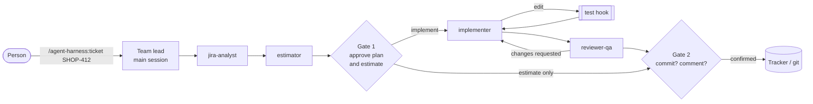

# agent-harness

[](https://github.com/bondie/agent-harness/actions/workflows/ci.yml)


**A ticket team for Claude Code, with an estimator you can check.** Four subagents take a
tracker ticket from analysis to a reviewed change: an analyst, an estimator, an implementer
and a reviewer. A person approves the plan and the estimate before any code is written, and
nothing is written to the tracker without their confirmation.

The estimator does not guess. It looks up how long similar finished tickets actually took
([reference class forecasting](https://en.wikipedia.org/wiki/Reference_class_forecasting))
through [ticket-precedent](https://github.com/bondie/ticket-precedent), and answers with a
median, a P25–P75 range and the tickets it relied on. The repository also contains the
backtest that measures it against simpler baselines, a local model and human estimates on
real, private ticket history; only aggregate numbers are published.

<!-- RESULTS-SUMMARY -->

## What is inside

It is a Claude Code [plugin](https://code.claude.com/docs/en/plugins), and the repository is
its own marketplace.

| Component | Role |
|---|---|
| `agent-harness:jira-analyst` | Reads the ticket, comments, links and precedents, finds the code; returns problem, acceptance criteria, approach, open questions. Read-only. |
| `agent-harness:estimator` | Reference class forecast in hours: median, P25–P75, cited tickets, named adjustments. Read-only. |
| `agent-harness:implementer` | Implements the approved approach test-first, inside its scope. Never commits or writes to the tracker. |
| `agent-harness:reviewer-qa` | Reviews the diff against the acceptance criteria, runs the checks, reports `path:line` findings and a verdict. Does not edit. |
| `/agent-harness:ticket KEY` | The team lead's playbook for the main session, with the two approval gates. |
| `hooks/run_tests.py` | After each edit **by the implementer**, runs the project's tests and hands failures back to it. |
| `hooks/guard_tracker_writes.py` | Denies tracker writes (comments, transitions, edits) to every subagent. |
| `.mcp.json` | Starts the ticket-precedent MCP server. |



## Install

```text
/plugin install agent-harness --marketplace bondie/agent-harness
```

Then, per project:

1. **An index of past tickets.** Set up [ticket-precedent](https://github.com/bondie/ticket-precedent)
   with your tracker and run `tp sync`. The plugin's `.mcp.json` starts its MCP server with
   `uvx`; if you already registered ticket-precedent yourself, remove one of the two.
2. **A tracker MCP server** of your choice (JIRA, GitHub, …) for the analyst to read tickets.
3. **The test command** for the hook, in the project's `.claude/settings.json` (see
   [`examples/settings.json`](examples/settings.json)):

   ```json
   { "env": { "HARNESS_TEST_COMMAND": "uv run pytest -x -q", "HARNESS_TEST_TIMEOUT": "300" } }
   ```

   `{file}` in the command becomes the edited file, e.g. `phpunit --filter … {file}`. Without
   the variable the hook does nothing.

## The estimator

The method is in [`agents/estimator.md`](agents/estimator.md):

1. Get the reference class: `effort_reference` returns the most similar tickets **whose time
   was all logged before the ticket was created**, with their hours, median and P25–P75.
2. Discard neighbours that only share vocabulary; open the closest ones when in doubt.
3. Anchor on the median, then adjust only for differences it can name.
4. Keep the P25–P75 range honest: it should contain the actual time half of the time.
5. Prefer neighbours from after a process change (or scale older ones down).

It never reads the ticket's existing estimate or logged time: a model shown a number anchors
on it ([Çalikli & Alhamed, FSE 2025](https://doi.org/10.1145/3715771)), and the person
comparing estimates needs an independent one.

<!-- RESULTS -->

## Design decisions

- **A plugin, not a project `.claude/` folder.** The same team works in every repository,
  including from the JetBrains and VS Code integrations, and updates in one place.
- **Hooks live in the plugin, filtered by agent.** Claude Code ignores `hooks`,
  `mcpServers` and `permissionMode` in the front matter of plugin agents, so the test hook is
  a plugin-level `PostToolUse` hook that checks `agent_type` and runs only for the
  implementer. An end-to-end run confirmed that it fires for the subagent's edits.
- **Tracker writes are blocked, not just discouraged.** The prompts say subagents only read;
  a `PreToolUse` hook enforces it for any MCP tool that looks like a tracker write. The main
  session keeps its normal permission prompt, and the playbook asks before every write.
- **Two human gates.** Between estimate and implementation (the expensive mistake is
  building the wrong thing) and before anything leaves the machine (commit, comment).
- **The eval runs the shipped prompt.** The LLM variants use the body of
  `agents/estimator.md` as their system prompt, so changing the agent changes the measured
  results.
- **Clean headless runs.** `claude -p` runs in an empty directory with no tools, no MCP
  servers and no settings (`--setting-sources ""`), so neither `CLAUDE.md` files nor hooks
  leak into the measurement. (`--bare` would do the same but requires an API key.)
- **Hours, not story points.** The trackers record logged hours, and story points correlate
  strongly with time in only 7% of the projects in the public TAWOS dataset
  ([Tawosi et al., ESEM 2022](https://doi.org/10.1145/3544902.3546238)).

## Prior art

- **Subagent teams:** [wshobson/agents `agent-teams`](https://github.com/wshobson/agents/tree/main/plugins/agent-teams)
  (lead, implementer, reviewer), [VoltAgent/awesome-claude-code-subagents](https://github.com/VoltAgent/awesome-claude-code-subagents)
  (conventions), [BMAD-METHOD](https://github.com/bmad-code-org/BMAD-METHOD) and
  [spec-kit](https://github.com/github/spec-kit) (human-reviewed artifacts between phases).
- **Estimation research:** Deep-SE and GPT2SP for story points, and their replications,
  which found that a plain median baseline is hard to beat and that temporal leakage
  inflated earlier results ([Tawosi et al., TSE 2023](https://arxiv.org/abs/2201.05401)).
  Hours from similar earlier issues go back to [Weiss et al., MSR 2007](https://doi.org/10.1109/MSR.2007.13).
- **LLM and RAG estimators:** retrieval-augmented story-point estimation was not
  significantly better than the baselines ([Maha et al., ICPC 2026](https://arxiv.org/abs/2604.03443));
  the choice of few-shot examples matters ([Tawosi et al., SSBSE 2023](https://arxiv.org/abs/2403.08430)).
  Existing Claude Code estimator agents (e.g. [ninja-agents `jira-story-points`](https://github.com/ninja-agents/ninja-agents/blob/main/.claude/agents/jira-story-points.md))
  are not evaluated.

What this repository adds: hours from private worklogs (no training-data contamination),
prediction ranges with measured coverage, a temporal cut-off inside the retrieval tool, a
baseline ladder that isolates what the LLM adds, human estimates, and a hosted and a local
model through the same pipeline.

## Development

```bash
uv sync                      # installs ticket-precedent from GitHub at a pinned commit
uv run pytest --cov          # no network, no model, no tracker needed
uv run ruff check . && uv run ruff format --check . && uv run mypy
claude plugin validate .
```

## License

[MIT](LICENSE)
